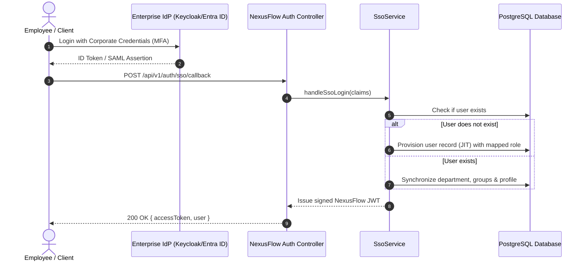

# NexusFlow Enterprise Developer & Architecture Manual

## 1. System Overview & Architecture

NexusFlow is an enterprise-grade hybrid orchestration and workflow automation platform combining the power of:
* **Camunda BPMN 2.0**: Standard business process modeling, user tasks, service tasks, and decision tables.
* **Temporal**: Durable execution, deterministic replay, point-in-time state rewind ("time travel"), and continue-as-new.
* **n8n DAG Workflow**: Dynamic directed acyclic graph execution, parallel branching, external webhooks, and REST connectors.
* **Kissflow / Case Management**: Ad-hoc human collaboration, state machines, consensus approvals, and audit trails.

The application follows **Clean Architecture & Hexagonal Ports/Adapters** using TypeScript and NestJS.

```
┌────────────────────────────────────────────────────────┐
│              Interfaces / Presentation Layer           │
│   HTTP Controllers, Guards, Filters, Interceptors, UI  │
└───────────────────────────┬────────────────────────────┘
                            │
┌───────────────────────────▼────────────────────────────┐
│                  Application Layer                     │
│    WorkflowEngine, TaskService, StorageService,        │
│    DistributedLockService, BpmnXmlService, SsoService  │
└───────────────────────────┬────────────────────────────┘
                            │
┌───────────────────────────▼────────────────────────────┐
│                    Domain Layer                        │
│   Entities, Invariants, Workflow Validator, Ports      │
└───────────────────────────┬────────────────────────────┘
                            │
┌───────────────────────────▼────────────────────────────┐
│                Infrastructure Layer                    │
│   PostgreSQL Drizzle, Redis, S3/NVMe Disk, Crypto      │
└────────────────────────────────────────────────────────┘
```

---

## 2. Pluggable Document Storage Vault

NexusFlow allows organizations to operate with **zero paid external storage dependencies** by default, while supporting seamless migration to private on-premise object storage or cloud providers.

### 2.1 Storage Drivers Configuration

Configure `FILE_STORAGE_DRIVER` in `.env`:

```env
# 1. Zero-Cost Local High-Performance NVMe / SSD (Default)
FILE_STORAGE_DRIVER=local
FILE_STORAGE_LOCAL_DIR=./data/storage

# 2. Zero-Cost PostgreSQL Binary Chunking (Single-Node All-In-One Container)
FILE_STORAGE_DRIVER=database

# 3. S3-Compatible Storage (On-Premises, Ethio Telecom Cloud, Cloudflare R2, or AWS S3)
FILE_STORAGE_DRIVER=s3_compatible
FILE_STORAGE_S3_ENDPOINT=https://s3.telecloud.et
FILE_STORAGE_S3_BUCKET=nexusflow-documents
FILE_STORAGE_S3_ACCESS_KEY=your-access-key
FILE_STORAGE_S3_SECRET_KEY=your-secret-key
FILE_STORAGE_S3_REGION=us-east-1
FILE_STORAGE_S3_FORCE_PATH_STYLE=true
```

### 2.2 S3 Deployment Matrix

| Provider / Target | Endpoint Example | Authentication | Notes |
| :--- | :--- | :--- | :--- |
| **Local Disk** | *N/A* | None (OS File System) | Fastest latency, zero network cost. Isolated per tenant. |
| **PostgreSQL DB** | *N/A* | Database Connection | Stored in base64 binary chunks inside `stored_files` table. |
| **Ethio Telecom Cloud** | `https://s3.telecloud.et` | AWS SigV4 (Access/Secret) | Sovereign Ethiopian cloud infrastructure; compliant with national data residency regulations. |
| **Cloudflare R2** | `https://<id>.r2.cloudflarestorage.com` | AWS SigV4 (Access/Secret) | Free tier (10 GB free forever), zero egress fees. |
| **On-Premise MinIO / Ceph** | `http://minio.internal:9000` | AWS SigV4 or Unauthenticated | Private on-premise data center object storage. |
| **Amazon Web Services (AWS S3)** | `https://s3.us-east-1.amazonaws.com` | AWS SigV4 (Access/Secret) | Standard AWS cloud infrastructure. |

### 2.3 Cryptographic Integrity

Every uploaded file automatically undergoes **SHA-256 hash computation** on ingestion. The hash is persisted with the document record and verified on download to guarantee immutable file integrity.

---

## 3. Distributed Concurrency & Multi-Node Cluster Locks

To safely run multiple background replicas of NexusFlow in a Kubernetes or load-balanced cluster without race conditions, NexusFlow provides two production-grade distributed locking mechanisms:

### 3.1 PostgreSQL Advisory Locks (`postgres_advisory`) — *Default*

* **Mechanism**: Uses native PostgreSQL 64-bit integer hashing (`SELECT pg_try_advisory_lock($1)`).
* **Advantages**: Zero additional servers required; operates seamlessly against your existing PostgreSQL database cluster.
* **Mutual Exclusion**: Non-blocking lock acquisitions ensure that background processes (such as timer evaluations, outbox polling, or scheduled cron workflows) run exclusively on exactly one cluster node at a time.
* **Automatic Session Cleanup**: Locks are bound to the specific database connection handle and released cleanly in `finally` blocks or upon graceful shutdown.

### 3.2 Redis Distributed Locking (`redis`)

* **Mechanism**: Uses `SET lock:<key> <lockId> NX PX <ttlMs>` with atomic Lua script releases:
  ```lua
  if redis.call("get", KEYS[1]) == ARGV[1] then
    return redis.call("del", KEYS[1])
  else
    return 0
  end
  ```
* **Configuration**: Set `CLUSTER_LOCK_DRIVER=redis` and `REDIS_URL=redis://localhost:6379`.

---

## 4. Standard BPMN 2.0 XML Engine Interoperability

NexusFlow bridges the gap between visual BPMN tools (such as **Camunda Modeler** and **Signavio**) and executable runtime workflows.

### 4.1 Node Mapping Specifications

| BPMN 2.0 XML Element | NexusFlow Node Type | Execution Behavior |
| :--- | :--- | :--- |
| `<bpmn:startEvent>` | `trigger.manual` | Workflow entry point with optional schema validation. |
| `<bpmn:userTask>` | `bpmn.user_task` | Suspends execution and creates an approval task for human assignees or candidate groups. |
| `<bpmn:serviceTask>` | `bpmn.service_task` | Automated service integration or external task topic handler. |
| `<bpmn:exclusiveGateway>` | `bpmn.exclusive_gateway` | Evaluates conditions on outgoing sequence flows. |
| `<bpmn:sequenceFlow>` | Edge (`from` -> `to`) | Connects nodes with optional JavaScript conditions (`conditionExpression`). |
| `<bpmn:endEvent>` | `bpmn.end` | Terminal node that completes the workflow instance. |

### 4.2 Programmatic BPMN API Usage

```typescript
// 1. Import BPMN 2.0 XML via HTTP
const res = await fetch('/api/v1/workflows/import-bpmn', {
  method: 'POST',
  headers: {
    'Content-Type': 'application/json',
    'Authorization': `Bearer ${adminToken}`,
  },
  body: JSON.stringify({
    xml: bpmnXmlString,
    key: 'vendor-onboarding-v1',
    name: 'Vendor Onboarding Process',
  }),
});

// 2. Export Workflow Definition to BPMN 2.0 XML
const xmlResponse = await fetch(`/api/v1/workflows/${workflowId}/export-bpmn`, {
  headers: { 'Authorization': `Bearer ${adminToken}` },
});
const exportedXml = await xmlResponse.text();
```

---

## 5. Enterprise Single Sign-On (SSO) & JIT Provisioning

NexusFlow supports identity federation with OpenID Connect (OIDC), SAML 2.0, Microsoft Entra ID (Azure AD), Keycloak, and Google Workspace.

### 5.1 Just-In-Time (JIT) Provisioning Flow



### 5.2 Group-to-Role Mapping Rules

Incoming directory groups in `groups: string[]` automatically resolve to NexusFlow roles:

* Contains `admin`, `system_admin`, `superusers` -> `ADMIN`
* Contains `hr`, `human_resources`, `people` -> `HR`
* Contains `operations`, `operator`, `devops`, `support` -> `OPERATOR`
* Contains `builder`, `architect`, `designer` -> `BUILDER`
* Contains `viewer`, `auditor`, `compliance` -> `VIEWER`
* Default fallback -> `USER`

---

## 6. Development & Deployment Procedures

### 6.1 Local Setup

```bash
# 1. Install dependencies
npm install

# 2. Run Database Migrations
npm run migrate

# 3. Seed Default Admin & Perspective Users
npm run seed

# 4. Start Backend Server
npm run dev

# 5. Start Frontend Studio (or run standalone built bundle)
npm --prefix frontend run dev
```

### 6.2 Running the Full Verification Test Suite

```bash
# Execute all 22 test suites (74 automated tests)
npm test

# Run TypeScript typecheck
npm run typecheck
```

