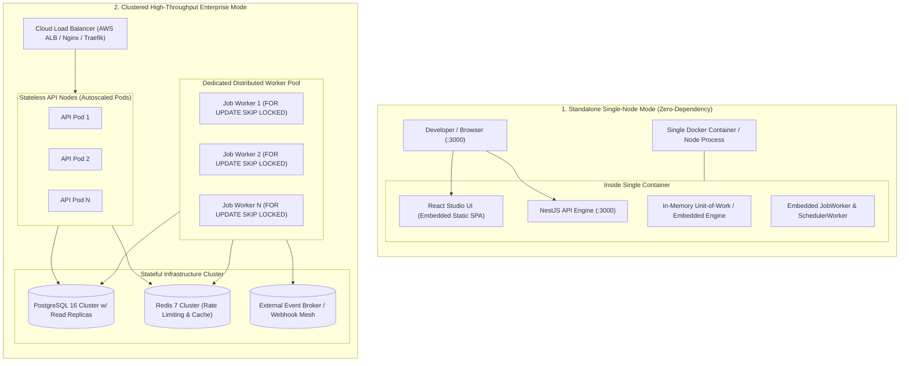

# NexusFlow Architecture: Unified 4-in-1 Workflow & Orchestration Engine

NexusFlow is an enterprise-grade orchestration platform reverse-engineering and fusing the four leading paradigm-defining workflow systems into a **single, unified, and cohesive runtime**:

```
+---------------------------------------------------------------------------------------------------------+
|                                        NEXUSFLOW UNIFIED PLATFORM                                       |
|                                                                                                         |
|   [ CAMUNDA ]                 [ n8n ]                     [ KISSFLOW ]             [ TEMPORAL ]         |
|   - BPMN 2.0 Tokens           - Safe {{ expr }} Engine    - Case & Milestones      - Time-Travel Reset  |
|   - Fork/Join Barriers        - Dynamic Connectors        - Intake & Task Forms    - Activity Heartbeat |
|   - External Worker Polling   - AES-256 Vault             - Quorum Consensus       - ParentClosePolicy  |
|   - DMN Decision Tables       - Webhook Ingestion         - 48h SLA Escalation     - ContinueAsNew      |
|   - Saga Reverse Rollback     - SSRF & Circuit Breaker    - Digital Minute Sheets  - Live Sync Query    |
+---------------------------------------------------------------------------------------------------------+
|                                         CORE WORKFLOW ENGINE                                            |
|                  State Machine · Dependency Graph · OCC Locks · Outbox Dispatcher                       |
+---------------------------------------------------------------------------------------------------------+
|                                     CLEAN ARCHITECTURE PERSISTENCE                                      |
|                  NestJS 10 · Drizzle ORM · PostgreSQL (FOR UPDATE SKIP LOCKED) · Redis                  |
+---------------------------------------------------------------------------------------------------------+
```

---

## 1. The Four Synthesized Pillars

| System | What NexusFlow Reverse Engineers | NexusFlow Implementation & Module |
|---|---|---|
| **Camunda** | Stateful BPMN 2.0 execution, Parallel split/join synchronization barriers, DMN Decision Tables (`FIRST` / `COLLECT`), external task worker polling (`fetch-and-lock`), message catch correlation, Cockpit incident recovery, and Saga reverse rollback handlers. | `src/application/engine/workflow-engine.ts`<br>`src/application/services/external-task-service.ts`<br>`src/domain/workflow/decision-table.ts`<br>`src/application/services/incident-service.ts` |
| **n8n** | Data pipelining and flow automation, sandboxed AST-safe recursive expressions (`{{ $trigger / $vars / $steps }}`), dynamic HTTP connectors, webhook triggers with signature verification, AES-256-GCM Credential Vault, and SSRF security guards. | `src/application/expressions/evaluator.ts`<br>`src/domain/workflow/validator.ts`<br>`src/infrastructure/security/crypto-vault.ts`<br>`src/infrastructure/security/ssrf-guard.ts` |
| **Kissflow** | Case-centric workflow portal, multi-stage milestone tracking (`stages`, `progressPercent`), dynamic forms with strict validation rules, approval matrices with consensus quorum (`Majority`, `All`, `Any`), SLA countdowns with auto-escalation, and threaded audit minutes. | `src/domain/workflow/form-validator.ts`<br>`src/application/services/case-service.ts`<br>`src/application/services/task-service.ts`<br>`src/infrastructure/workers/scheduler-worker.ts` |
| **Temporal** | Resilient code-first orchestration primitives: Point-in-Time Reset (time-travel rewind with variable overrides and token resumption), Activity Heartbeating ($0-100\%$ progress reporting without timeout), ParentClosePolicy cascade cancellation (`TERMINATE`, `ABANDON`, `REQUEST_CANCEL`), Continue-As-New history compaction, and Synchronous Live Workflow Queries. | `src/domain/execution/types.ts`<br>`src/domain/execution/state-machine.ts`<br>`src/application/engine/workflow-engine.ts`<br>`POST /api/v1/instances/:id/reset`<br>`POST /api/v1/instances/:id/continue-as-new`<br>`POST /api/v1/instances/:id/query` |

---

## 2. Layered Boundaries

```
src/
├── domain/                  # Pure enterprise business rules (0 framework dependencies)
│   ├── errors.ts            # Typed DomainError hierarchy -> HTTP status mapping
│   ├── ports/               # Repository, UnitOfWork, ICredentialVault, Telemetry ports
│   ├── workflow/            # Graph validator, DMN evaluator, Form Schema validator, Tenant Import
│   ├── execution/           # Token/Instance/Task/ExternalTask/Case state machines & types
│   ├── localization/        # Ethiopian Ge'ez calendar anchor converter (13 months)
│   └── security/            # RBAC roles, Digital Seals (HMAC-SHA256) & permissions matrix
├── application/             # Use cases, orchestration engine, sandboxed expressions
│   ├── engine/              # WorkflowEngine (BPMN tokens, Temporal reset/continueAsNew/queries, Saga)
│   ├── expressions/         # Recursive-descent AST-safe {{ ... }} evaluator (zero eval/Function)
│   ├── services/            # Task (Quorum/Delegate/SLA), Case, Correspondence, Telegram, Importer
│   └── templates/           # Ethiopian Model 20 store voucher & Field mission per-diem definitions
├── infrastructure/          # Concrete adapters
│   ├── db/                  # Drizzle ORM PostgreSQL schema (schema.ts), pg.Pool, SQL migrator
│   ├── repositories/        # Drizzle PostgresUnitOfWork (SKIP LOCKED + OCC) & MemoryUnitOfWork
│   ├── security/            # AES-256-GCM Credential Vault, scrypt hashing, SSRF CIDR guard
│   ├── resilience/          # Per-host Circuit Breaker & exponential backoff w/ full jitter
│   ├── observability/       # AsyncLocalStorage context, Pino redaction, Prometheus metrics
│   └── workers/             # JobWorker & SchedulerWorker (timers, cron, SLA escalations, outbox)
└── interfaces/http/         # NestJS REST API, Guards, Interceptors, Pipes, Swagger OpenAPI
```

---

## 3. Unified Execution Engine

The beauty of NexusFlow is that these four systems do not exist as disparate microservices or taped-together scripts. They operate on **one unified execution token and case model**:

1. An **n8n Webhook** or **Kissflow Self-Service Form** initiates a workflow instance.
2. The engine evaluates **Camunda BPMN token routing** with parallel forks and DMN decision tables.
3. If an activity is long-running, an external worker polls it via **Camunda fetch-and-lock** while reporting **Temporal activity heartbeats and percentage progress**.
4. If a business policy requires human consent, the step transitions to a **Kissflow consensus quorum** with SLA countdowns and Amharic minute sheets (*የማስታወሻ ቅጽ*).
5. If an unexpected operational error occurs, operators can execute a **Temporal Point-in-Time Reset** to rewind the workflow back to any prior step without losing state or corrupting the database.
6. Periodic cycles compact automatically using **Temporal Continue-As-New**.
7. If unrecoverable errors occur in a distributed transaction, the **Camunda Saga compensation engine** fires backward rollback handlers in exact reverse order.

2. **Drizzle ORM + PostgreSQL `FOR UPDATE SKIP LOCKED` + Optimistic Concurrency Control**
   - Strongly-typed Drizzle schema in [schema.ts](file:///c:/Users/mequanint.acham/Desktop/pfile/nexusflow/src/infrastructure/db/schema.ts) and Drizzle Unit of Work in [postgres-uow.ts](file:///c:/Users/mequanint.acham/Desktop/pfile/nexusflow/src/infrastructure/repositories/postgres/postgres-uow.ts).
   - Multi-worker job claiming via `.for('update', { skipLocked: true })` and `workflow_instances.occ_version` checks.
3. **Transactional Outbox Pattern**
   - Domain mutations and `outbox_events` inserts commit in one ACID Drizzle transaction and are relayed asynchronously by `SchedulerWorker`.
4. **Defense-in-Depth Security & Multi-Tenancy**
   - **Enterprise Multi-Tenancy**: Native `tenant_id` partitioning across all core tables (`tenants`, `workflows`, `workflow_instances`, `user_tasks`, `notifications`, `credentials`, `users`, `api_keys`). Tenants have completely isolated workflow definitions (composite unique constraint `(tenant_id, key, version)`), independent instances, and isolated credentials.
   - JWT + SHA-256 hashed API keys (`nxf_...`) with 4-role RBAC (`ADMIN`, `BUILDER`, `OPERATOR`, `VIEWER`), carrying embedded `tenantId`.
   - AES-256-GCM Credential Vault with key rotation (`VAULT_MASTER_KEY_V1` / `V2`) scoped by tenant.
   - SSRF Guard blocking loopback, RFC1918 private networks, IPv6 ULA, and cloud metadata (`169.254.169.254`).

---

## 4. Standalone vs. Clustered Deployment Flexibility

NexusFlow is engineered with architectural duality: it can run **completely standalone** on a single laptop/developer container with zero external dependencies, or scale to a **globally distributed cluster** processing millions of events per day.



### Mode Comparison Matrix

| Feature | Standalone Mode (`STORAGE_DRIVER=memory`) | Clustered Mode (`STORAGE_DRIVER=postgres`) |
|---|---|---|
| **External Dependencies** | **Zero** (no PostgreSQL, no Redis, no message broker required) | PostgreSQL 16+ & Redis 7+ |
| **Frontend UI Serving** | Embedded static serving of React Studio bundle at `http://localhost:3000/` | Served via CDN / S3 / Nginx or through API pods |
| **Worker Threads** | Embedded `JobWorker` & `SchedulerWorker` in API process | Separate autoscaled worker pool (`node dist/worker.js`) |
| **Throughput Target** | Up to 1,500 operations/sec on a modern multicore laptop | Up to 45,000+ operations/sec horizontally scaled |
| **Startup Command** | `docker run -p 3000:3000 mequann/nexusflow` or `npm start` | `docker-compose up -d` or Helm charts on Kubernetes |
| **Target Audience** | Local developers, edge gateways, branches, small businesses | Tier-1 Banks, Telecoms, Healthcare networks, Fortune 500 SaaS |

---

## 5. Senior Architect Resiliency & Reliability Mechanisms

1. **Optimistic Concurrency Control (OCC) with Retry-On-Conflict**:
   - `workflow_instances` carries an `occ_version` column. State transitions increment this counter atomically (`UPDATE workflow_instances SET occ_version = occ_version + 1 WHERE id = $1 AND occ_version = $2`).
   - Prevents race conditions and lost updates when multiple webhooks, activity heartbeats, and user tasks complete concurrently.

2. **Distributed Queue Claiming (`FOR UPDATE SKIP LOCKED`)**:
   - Multiple background worker instances concurrently query the `execution_jobs` table:
     ```sql
     SELECT * FROM execution_jobs
     WHERE status = 'PENDING' AND available_at <= NOW()
     ORDER BY available_at ASC
     LIMIT 10
     FOR UPDATE SKIP LOCKED;
     ```
   - Zero worker contention, zero row locking bottlenecks, and partition-free linear scalability.

3. **Transactional Outbox Pattern**:
   - Domain mutations (instance completion, user task creation, incident events) and outbox records are inserted within the **exact same ACID database transaction**.
   - `SchedulerWorker` and `EventDispatcherService` pull pending events and reliably dispatch them to external consumers (HTTP Webhooks, Kafka, Redis Streams) with HMAC-SHA256 signature verification.
   - Eliminates Dual-Write Hazards and guarantees at-least-once message delivery.

4. **Poison-Pill Quarantine & Dead-Letter Queue (DLQ)**:
   - When a job repeatedly fails and exhausts its configured retry policy (exponential backoff with full jitter), it is safely quarantined into `DEAD` status and an open `Incident` is registered with stack trace and input snapshots.
   - Prevents bad payloads from clogging the worker queue while providing operators one-click Cockpit remediation.

5. **Per-Host Circuit Breaker**:
   - Outbound REST connectors are protected by `CircuitBreakerRegistry` (`CLOSED` -> `OPEN` -> `HALF_OPEN`).
   - If a third-party microservice fails (5 consecutive errors), the circuit trips OPEN for 30s to prevent socket exhaustion and cascading thread starvation.

6. **Graceful Shutdown & Drain**:
   - API and Worker nodes intercept `SIGTERM`/`SIGINT`, pause new job claims from the database, and allow active in-flight executions up to 10 seconds to finish cleanly before closing database connection pools.

---

## 6. Official Polyglot Client SDK (`NexusFlowClient`)

External systems across any language (Node.js, TypeScript, Python, Go, Java, C#) can integrate seamlessly with NexusFlow. For TypeScript/Node applications, the official typed SDK provides first-class ergonomics:

```typescript
import { NexusFlowClient } from 'nexusflow/sdk';

const client = new NexusFlowClient({
  baseUrl: 'https://orchestrator.company.com',
  apiKey: process.env.NEXUSFLOW_API_KEY,
  tenantId: 'commercial-bank-of-ethiopia',
});

// 1. Start a workflow with idempotency deduplication
const instance = await client.workflows.start('banking-loan-origination', {
  variables: { applicantId: 'CBE-98214', requestedAmount: 500000 },
  idempotencyKey: 'loan-req-2026-11-13-98214',
});

// 2. Autonomous Polyglot Remote Worker Loop (Temporal/Camunda style)
const worker = client.createWorker({
  topic: 'core-banking-credit-check',
  workerId: 'credit-worker-node-01',
  concurrency: 5,
  heartbeatIntervalMs: 5000,
}, async (task) => {
  // Activity Heartbeating: report progress during long-running execution
  await task.heartbeat({ progressPercent: 45, status: 'fetching-nbe-delinquency' });
  
  // Return result variables to complete the task and resume workflow execution
  return { approved: true, creditScore: 785, maxEligibleAmount: 600000 };
});

worker.start();

// 3. Await final terminal status
const result = await client.workflows.waitForCompletion(instance.id, {
  timeoutMs: 30000,
});
console.log('Workflow Finished:', result.status, result.variables);
```

---

## 7. Outbound Event Dispatching & Integration Webhooks

When workflow events occur, NexusFlow's `EventDispatcherService` signs outgoing HTTP webhook notifications with an HMAC-SHA256 signature header:

```http
POST /nexusflow-events HTTP/1.1
Host: api.enterprise-hub.com
Content-Type: application/json
X-NexusFlow-Delivery: 9ee0134f-725b-4462-8a71-2c744c1c89c4
X-NexusFlow-Event: INSTANCE_COMPLETED
X-NexusFlow-Timestamp: 2026-11-13T12:55:52.562Z
X-NexusFlow-Signature: sha256=d5b3a4c0...

{
  "id": "9ee0134f-725b-4462-8a71-2c744c1c89c4",
  "eventType": "INSTANCE_COMPLETED",
  "aggregateType": "WorkflowInstance",
  "aggregateId": "45ef3ba9-c902-4bdb-bed4-9be8b097f58c",
  "payload": {
    "instanceId": "45ef3ba9-c902-4bdb-bed4-9be8b097f58c",
    "workflowKey": "banking-loan-origination",
    "variables": { "approved": true, "loanAccountId": "CBE-LN-4421" }
  }
}
```
External systems verify incoming requests by hashing the body with their shared webhook secret:
```typescript
const calculated = crypto.createHmac('sha256', secret).update(rawBody).digest('hex');
if (calculated !== headerSignature.replace('sha256=', '')) {
  throw new UnauthorizedException('Invalid NexusFlow signature');
}
```
