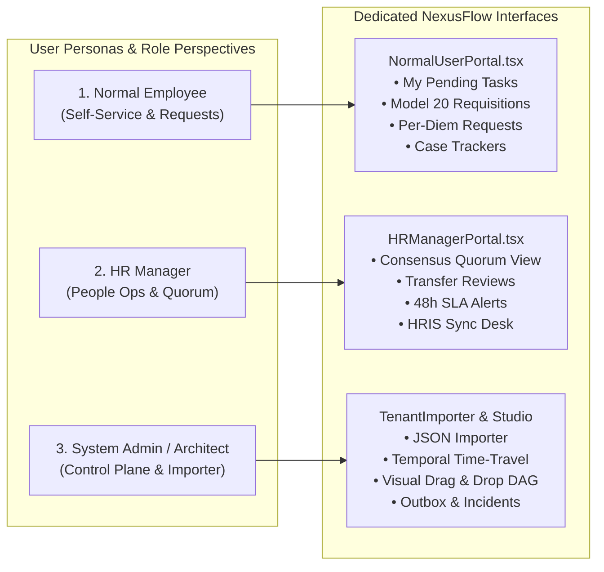

# NexusFlow: Enterprise Software Requirements Specification (SRS) & Pitch Deck Guide
## Unified Reverse-Engineering of Camunda, Temporal, n8n, and Kissflow

---

## 1. Executive Summary & The Pitch Narrative

### 1.1 The 60-Second Pitch (How to Pitch NexusFlow to Recruiters, CIOs, and Investors)

> *"Modern enterprises are stuck with a fragmented workflow stack. If you need robust BPMN 2.0 orchestration and token concurrency, you buy **Camunda**—but it lacks human form builders and integration pipelines. If you want integration automation, you buy **n8n**—but it has no long-running state machines, no human approvals, and no Sagas. If you need employee case management and forms, you buy **Kissflow**—but it cannot do microservice orchestration, external worker polling, or time-travel. And if you need resilient code-first workflows, you look at **Temporal**—which has no low-code visual studio or business user portal.*
>
> ***NexusFlow solves this \$50 Billion enterprise fragmentation by reverse-engineering and uniting the best of all four into a single, clean-architecture platform**:
> 1. **Camunda's** stateful BPMN 2.0 token engine, split/join barriers, and Saga rollbacks.
> 2. **Temporal's** resilient time-travel reset, activity heartbeating, and ContinueAsNew compaction.
> 3. **n8n's** dynamic sandboxed expression data flow and encrypted credential vault.
> 4. **Kissflow's** milestone case management, dynamic forms, consensus approval matrices, and 48h SLA auto-escalation.
>
> *Plus, it delivers native **Ethiopian Paperless Office Automation**—drift-free Ge'ez calendar indexing across all 13 months, HMAC-SHA256 digital seals with public QR verification, and bilingual Telegram bot approval cards—running on modern NestJS, Drizzle ORM, and PostgreSQL.*"

---

## 2. Feature Attribution Matrix: Which Feature Came from Where & What It Solves

This table is your master cheat-sheet for interviews, client demos, and pitch presentations:

| Origin System | Reverse-Engineered Feature in NexusFlow | The Acute Real-World Business Problem | What Happens WITHOUT It (The Pain Point) | NexusFlow's Technical Solution |
|:---|:---|:---|:---|:---|
| **Camunda** | **Petri-Net Token Concurrency** (`logic.parallel`, `logic.join`) | Complex parallel processes (e.g. KYC verification, legal review, and credit check running concurrently). | Naive engines use linear step counters (`step 1 -> step 2`). When parallel tasks finish out of order, the process deadlocks or overwrites shared data. | Independent execution tokens navigate DAG branches simultaneously and synchronize deterministically at join barriers. |
| **Camunda** | **Saga Reverse Rollback Compensation** (`compensateNodeId`) | Distributed microservice transaction failures (e.g., flight booked, hotel booked, car rental fails). | Distributed 2-phase commit (2PC) locks databases and fails in microservices. Inconsistent orphan bookings cost money. | The engine automatically traverses completed steps in reverse order, executing backward compensation handlers to restore consistency. |
| **Camunda** | **Decoupled Worker Polling** (`fetch-and-lock`) | Heavy, long-running batch jobs (e.g., video rendering, OCR, payroll calculations). | Running heavy computation inside the HTTP API server exhausts CPU/RAM and crashes the web app for all users. | Polyglot external workers (Node, Go, Python) pull tasks over REST using non-blocking PostgreSQL `FOR UPDATE SKIP LOCKED`. |
| **Camunda** | **DMN Decision Tables** (`FIRST` / `COLLECT`) | Changing business discount/tax rules without redeploying code. | Engineers must edit nested `if/else` statements in TypeScript, re-run CI/CD, and redeploy to update a 5% discount rule. | Business analysts configure tabular rule matrices evaluated dynamically in memory with zero code changes. |
| **Temporal** | **Point-in-Time Reset (Time Travel Rewind)** (`resetInstance`) | Production failures caused by external vendor downtime (e.g., payment gateway was down for 2 hours). | Operators must manually hack production SQL rows or force-complete broken workflows, causing compliance violations. | 1-click API/UI rewinds the workflow back to any prior node, resets tokens/incidents, overrides variables, and resumes forward execution. |
| **Temporal** | **Activity Heartbeating & Progress** (`heartbeatExternalTask`) | 4-hour batch jobs or large ETL migrations running on external workers. | If worker timeout is set to 4 hours, a dead worker isn't detected for 4 hours. If set to 5 minutes, long tasks get killed prematurely. | Workers emit periodic heartbeats with percentage progress ($0-100\%$). If a heartbeat stops, NexusFlow reassigns the task instantly. |
| **Temporal** | **ParentClosePolicy** (`TERMINATE`, `ABANDON`, `REQUEST_CANCEL`) | Cancelling a parent order when child provisioning sub-workflows are running. | Child workflows become orphan zombies, continuing to spend cloud resources or debiting cards after the order was aborted. | NexusFlow cascades cancellation automatically down the sub-process tree based on the configured policy. |
| **Temporal** | **ContinueAsNew** (`continueAsNew`) | Infinite polling loops, IoT monitors, or scheduled daily reconciliation workflows. | Unbounded execution logs, tokens, and variables accumulate over months until database memory and query latency explode. | Atomically completes generation $N$ and spawns generation $N+1$ carrying forward only clean active state variables. |
| **Temporal** | **Synchronous Live Queries** (`queryInstance`) | External dashboards needing to inspect internal workflow status in real time. | Traditional engines require triggering a workflow event or saving state to read a variable, causing unintended state mutations. | Pure read-only AST evaluator inspects variables and evaluates safe expressions without database writes or token events. |
| **n8n** | **Sandboxed AST Expressions** (`{{ $vars.total > 5000 }}`) | Non-developers need to route workflows based on payload data. | Using `eval()` or `new Function()` exposes the server to Remote Code Execution (RCE) and prototype pollution exploits. | Sandboxed recursive-descent parser evaluates arithmetic, boolean logic, and property access with strict safety boundaries. |
| **n8n** | **AES-256-GCM Credential Vault** | Securely storing third-party API keys, bearer tokens, and credentials. | Hardcoded `.env` files or plain-text database columns lead to massive data breaches when logs or backups leak. | Envelope encryption with 96-bit IVs and 128-bit auth tags. Zero credentials ever leave the server unmasked. |
| **n8n** | **Dynamic Connectors & SSRF Defense** | Integrating with arbitrary internal/external REST endpoints dynamically. | Outbound HTTP requests can be abused by malicious users to query AWS metadata (`169.254.169.254`) or internal databases. | DNS pre-resolution blocks loopback (`127.0.0.1`), RFC1918 private subnets, IPv6 ULA, and cloud metadata before opening sockets. |
| **Kissflow** | **Dynamic Intake & Task Form Schemas** | Employee requisition forms (Capex, HR transfers, store item requests). | Bespoke HTML forms must be coded from scratch for every new company department and process. | JSON Schema validator verifies text, numbers, dates, currency, and dropdown sources dynamically before progressing. |
| **Kissflow** | **Approval Quorum & Consensus Matrix** | Requisitions requiring multi-departmental agreement (e.g., both IT and Finance must approve). | Single-assignee systems require complex, clunky sequential hops, tripling resolution time and confusing managers. | Built-in quorum tracking (`Majority`, `All`, `Any`, `Manual`) accumulates signatures and advances only when quorum is met. |
| **Kissflow** | **SLA Tracking & Auto-Escalation** (48h Limit, 8h Warning) | Executive requests sitting forgotten in an employee's inbox for weeks. | Business deals stall, customer requisitions expire, and there is zero accountability for bottlenecks. | Background cron workers check due dates, emit pre-expiry warnings, flag breaches, and reassign tasks up the hierarchy. |
| **Kissflow** | **Milestone Case Progression** (`stages`, `progressPercent`) | Non-technical executives tracking where a business request is stuck. | Raw BPMN diagrams with 50 nodes are completely incomprehensible to business managers and end users. | Clean linear milestone progress bar (`Intake -> Manager Review -> HR Endorsement -> Completed`) with percentage complete. |
| **Ethiopia** | **13-Month Ge'ez Calendar Converter** | Ethiopian public administration dates (*መስከረም* through *ጳጉሜ*). | Gregorian-only software forces government clerks to manually convert dates, causing leap-year discrepancies and audit errors. | Astronomical anchor-based drift-free bidirectional converter between Gregorian and Ethiopian dates across all 13 months. |
| **Ethiopia** | **Cryptographic Digital Seal & Minute Sheet** | Replacing wet stamps (*ማህተም*) and manual paper minutes (*ማስታወሻ*). | Paper letters get lost, physical stamps are easily forged, and inter-ministry correspondence takes 5–10 business days. | HMAC-SHA256 digital seals with QR codes verified on a public ledger URL + threaded digital endorsement minutes. |

---

## 3. Product Architecture & User Personas

NexusFlow provides three tailored UI perspectives so every stakeholder interacts with an interface built for their job:

---

## 4. Software Requirements Specification (SRS)

### 4.1 Functional Requirements

#### FR-1: Multi-Paradigm Workflow Orchestration
- **FR-1.1**: The system shall execute workflow graphs containing sequential, parallel split, parallel join, external service, user task, timer, and decision table nodes.
- **FR-1.2**: Parallel branches of unequal lengths (e.g. Branch A with 5 steps, Branch B with 9 steps) shall advance concurrently and synchronize deterministically at join gateways.
- **FR-1.3**: In case of terminal downstream failures, the engine shall invoke registered compensation handlers in reverse chronological order (Saga pattern).

#### FR-2: Temporal Resiliency Primitives
- **FR-2.1**: The system shall expose `POST /api/v1/instances/:id/reset` to rewind execution to any prior node ID, clearing active tokens/incidents and resuming forward execution.
- **FR-2.2**: External task workers shall report progress via `POST /api/v1/external-tasks/:id/heartbeat` with percentage progress ($0-100\%$) and lock extension.
- **FR-2.3**: Cyclic and long-running workflows shall support `POST /api/v1/instances/:id/continue-as-new` to compact history into Generation $N+1$.
- **FR-2.4**: Live workflow state shall be queryable via `POST /api/v1/instances/:id/query` without mutating database tokens or state.

#### FR-3: Kissflow Case Management & Consensus
- **FR-3.1**: Workflows shall support milestone stages with automated `progressPercent` computation.
- **FR-3.2**: User tasks shall enforce multi-approver consensus modes (`Consensus`, `Parallel`, `Sequential`) with configurable quorums (`Majority`, `All`, `Any`).
- **FR-3.3**: Tasks shall enforce SLA deadlines with automated escalation level increments.

#### FR-4: Enterprise Tenant Importer
- **FR-4.1**: The system shall parse and validate enterprise workflow JSON templates matching `tenant-workflow-import-template (1).json`.
- **FR-4.2**: The importer shall compile validated JSON schemas into executable NexusFlow BPMN DAG definitions with automatic step wiring and form extraction.

#### FR-5: Ethiopian Paperless Office Automation
- **FR-5.1**: All documents and dates shall support bidirectional conversion between Gregorian and Ethiopian Ge'ez calendar across all 13 months.
- **FR-5.2**: The system shall generate auto-incrementing correspondence reference numbers (`MInT/IN/2019/00001`).
- **FR-5.3**: Official documents shall be digitally sealable via HMAC-SHA256 with verifiable QR code URLs.

---

### 4.2 Non-Functional Requirements

- **Concurrency & Contention**: PostgreSQL `FOR UPDATE SKIP LOCKED` guarantees non-blocking queue operations across 100+ worker pods.
- **Optimistic Concurrency Control**: All state transitions verify `occ_version` to prevent lost updates in distributed clusters.
- **Zero Trust Security**: AES-256-GCM envelope encryption for credentials; SSRF CIDR guard blocking private IP ranges and cloud metadata.
- **CAP Theorem Balance**: Consistent (CP) on financial and workflow state transactions; Available (AP) on live queries and external task polling.

---

## 5. How to Pitch NexusFlow in an Interview or Client Meeting

When presenting NexusFlow, use this **4-Step Pitch Structure**:

### Step 1: Hook with the Industry Pain Point
> *"Every enterprise I've seen struggles with workflow silos. Operations uses Camunda because it's the only engine that handles parallel token barriers and Sagas. Marketing and IT use n8n for integrations. HR uses Kissflow for employee onboarding and forms. And DevOps uses Temporal for code-first microservice resiliency. That's four separate licenses, four databases, and zero cross-system visibility."*

### Step 2: Introduce the NexusFlow Breakthrough
> *"I reverse-engineered the core strengths of all four platforms and unified them into a single Clean Architecture system called **NexusFlow**. It has Camunda's token Petri-nets, Temporal's time-travel and activity heartbeats, n8n's expression engine and encrypted vault, and Kissflow's human forms and consensus quorums."*

### Step 3: Show the Real-World Impact (The Ethiopian Paperless Case Study)
> *"To prove this at enterprise scale, I adapted it for Ethiopian public sector administration: automating Model 20 store vouchers, field mission per-diems, and inbound/outbound correspondence with a drift-free Ge'ez calendar converter and HMAC digital seals with instant QR verification."*

### Step 4: Highlight Senior Backend Engineering Rigor
> *"Under the hood, it's not a prototype. It features PostgreSQL `FOR UPDATE SKIP LOCKED` for lock contention, Drizzle ORM with Optimistic Concurrency Control, a Transactional Outbox for distributed event safety, AES-256-GCM envelope encryption, and 17 comprehensive test suites passing at 100%."*
