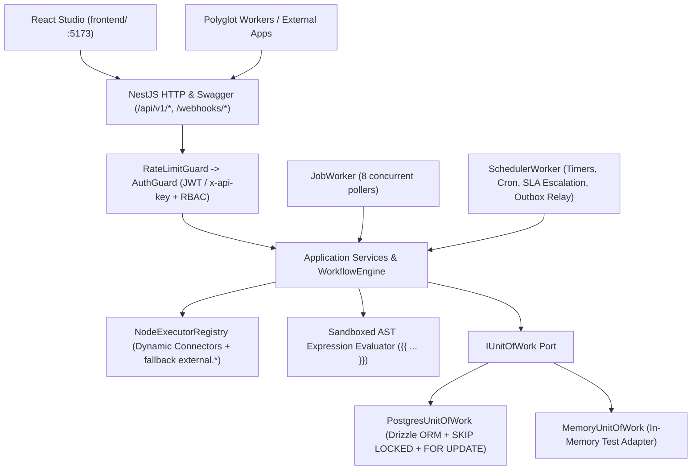

# NexusFlow — Production Architecture, Upgrade, Integration & HRIS Directory Guide

This document explains **how NexusFlow works internally**, **how to harden and ship it to production**, **how to upgrade it safely**, and **how to deploy it standalone, embed it as a NestJS module, or integrate external HRIS / Identity systems** (to bring in real users, org hierarchies, managers, and OOO status).

---

## 1. How NexusFlow Works Today

NexusFlow is a hybrid **Camunda BPMN + n8n Automation + Kissflow Case Management** orchestration platform built with **NestJS 11**, **TypeScript**, **Drizzle ORM**, **PostgreSQL**, and a **React + Vite** visual Studio (`frontend/`).

### 1.1 Architectural Layers (`src/`)



| Layer | Responsibility | Key Files |
|---|---|---|
| **Domain** (`src/domain/`) | Zero-framework business rules, DAG/form/DMN validators, state machines, RBAC permissions, repository ports | [workflow/validator.ts](file:///c:/Users/mequanint.acham/Desktop/pfile/nexusflow/src/domain/workflow/validator.ts), [decision-table.ts](file:///c:/Users/mequanint.acham/Desktop/pfile/nexusflow/src/domain/workflow/decision-table.ts), [form-validator.ts](file:///c:/Users/mequanint.acham/Desktop/pfile/nexusflow/src/domain/workflow/form-validator.ts), [repositories.ts](file:///c:/Users/mequanint.acham/Desktop/pfile/nexusflow/src/domain/ports/repositories.ts) |
| **Application** (`src/application/`) | Token-based `WorkflowEngine`, `NodeExecutorRegistry`, sandboxed `{{ ... }}` parser, services (`Auth`, `Workflow`, `Task`, `Case`, `ExternalTask`, `Incident`, `Message`, `Credential`) | [workflow-engine.ts](file:///c:/Users/mequanint.acham/Desktop/pfile/nexusflow/src/application/engine/workflow-engine.ts), [node-executors.ts](file:///c:/Users/mequanint.acham/Desktop/pfile/nexusflow/src/application/engine/node-executors.ts), [evaluator.ts](file:///c:/Users/mequanint.acham/Desktop/pfile/nexusflow/src/application/expressions/evaluator.ts) |
| **Infrastructure** (`src/infrastructure/`) | Drizzle ORM schema & PostgreSQL UoW, AES-256-GCM vault, SSRF guard, Circuit Breaker, Pino logger, Prometheus metrics, `JobWorker`, `SchedulerWorker` | [schema.ts](file:///c:/Users/mequanint.acham/Desktop/pfile/nexusflow/src/infrastructure/db/schema.ts), [postgres-uow.ts](file:///c:/Users/mequanint.acham/Desktop/pfile/nexusflow/src/infrastructure/repositories/postgres/postgres-uow.ts), [job-worker.ts](file:///c:/Users/mequanint.acham/Desktop/pfile/nexusflow/src/infrastructure/workers/job-worker.ts), [scheduler-worker.ts](file:///c:/Users/mequanint.acham/Desktop/pfile/nexusflow/src/infrastructure/workers/scheduler-worker.ts) |
| **Interfaces** (`src/interfaces/http/`) | NestJS controllers, Swagger OpenAPI DTOs (`/docs`), `AuthGuard`, `RateLimitGuard`, `IdempotencyInterceptor`, `DomainExceptionFilter` | [app.module.ts](file:///c:/Users/mequanint.acham/Desktop/pfile/nexusflow/src/app.module.ts), [api.dto.ts](file:///c:/Users/mequanint.acham/Desktop/pfile/nexusflow/src/interfaces/http/dto/api.dto.ts) |
| **Frontend** (`frontend/`) | React 19 + Vite Studio: Drag-and-Drop Sequential/Parallel Designer, edge `+`/`×` controls, Case Portal, Approval Inbox, Incidents, Connectors & Vault | [App.tsx](file:///c:/Users/mequanint.acham/Desktop/pfile/nexusflow/frontend/src/App.tsx), [WorkflowDesigner.tsx](file:///c:/Users/mequanint.acham/Desktop/pfile/nexusflow/frontend/src/components/WorkflowDesigner.tsx) |

### 1.2 Execution, Concurrency & Rollback Mechanics

1. **Workflow Versioning & Immutability**:
   - Workflows are authored in `DRAFT` (`POST /api/v1/workflows`, `PUT /api/v1/workflows/:id`) and validated before publishing (`POST /api/v1/workflows/:id/publish`).
   - Publishing archives older `PUBLISHED` versions of the same `key`. Running instances stay pinned to `(workflowId, workflowVersion)` so new versions never break in-flight cases.
2. **Token-Driven Progression (`WorkflowEngine`)**:
   - `startInstance` creates a `WorkflowInstance` (`RUNNING`), a root `ExecutionToken`, an `EXECUTE_NODE` job, and an `INSTANCE_STARTED` outbox event in a single ACID transaction.
   - `JobWorker` claims jobs with PostgreSQL `FOR UPDATE SKIP LOCKED` ([`postgres-uow.ts`](file:///c:/Users/mequanint.acham/Desktop/pfile/nexusflow/src/infrastructure/repositories/postgres/postgres-uow.ts#L502-L545)).
   - Inside `handleExecuteNode` and `handleResumeToken`, `findByIdForUpdate` acquires a row-level `FOR UPDATE` lock on `workflow_instances`, preventing concurrent parallel branches (even unequal-length branches such as 5 steps vs 9 steps) from colliding on `occ_version` or missing `logic.join` barrier arrivals.
   - Wait states (`bpmn.user_task`, `kissflow.approval_matrix`, `bpmn.timer`, `bpmn.message_catch`, `bpmn.external_task`, `bpmn.call_activity`) park the token in `WAITING` and resume via a `RESUME_TOKEN` job once resolved.
3. **Failure Handling & Saga Rollback**:
   - Retryable errors (`ExternalServiceError.retryable` or transient `ConflictError`) reschedule with exponential backoff + full jitter ([`retry.ts`](file:///c:/Users/mequanint.acham/Desktop/pfile/nexusflow/src/infrastructure/resilience/retry.ts)).
   - After retries exhaust:
     - If `sagaEnabled: true`, `executeCompensation` walks `COMPLETED` steps with `compensateNodeId` in **reverse completion order**, executing each compensation handler and transitioning the instance to `COMPENSATED`.
     - If `sagaEnabled: false`, an `Incident` (`OPEN`) is created (`INCIDENT_OPEN`) for operator recovery (`RETRY`, `COMPENSATE`, or `FAIL`).

---

## 2. Production Deployment & Shipping Guide

### 2.1 Recommended Production Process Topology

Run the API tier and Worker tier as **separate processes** (already supported by [main.ts](file:///c:/Users/mequanint.acham/Desktop/pfile/nexusflow/src/main.ts), [worker.ts](file:///c:/Users/mequanint.acham/Desktop/pfile/nexusflow/src/worker.ts), and [docker-compose.yml](file:///c:/Users/mequanint.acham/Desktop/pfile/nexusflow/docker-compose.yml)):

- **API Replicas (`node dist/main.js`)**: Set `ENABLE_EMBEDDED_WORKERS=false`. Scale horizontally behind an HTTPS Load Balancer / Ingress (Nginx, Envoy, ALB, Cloudflare).
- **Worker Replicas (`node dist/worker.js`)**: Scale horizontally; `FOR UPDATE SKIP LOCKED` ensures two workers never process the same execution job or external task simultaneously.
- **Database Migrations (`npm run migrate`)**: Run as a pre-deploy job/init container before rolling new API/worker pods.
- **Frontend Static Hosting**: Build `npm run build:frontend` and serve `frontend/dist/` via CDN/Nginx with `/api/*` and `/webhooks/*` routed to the NestJS API.

### 2.2 Production Environment Checklist

| Setting | Dev Default | Production Requirement |
|---|---|---|
| `NODE_ENV` | `development` | `production` |
| `STORAGE_DRIVER` | `memory` / `postgres` | `postgres` |
| `DB_SSL` | `false` | `true` (or TLS `sslmode=require` in `DATABASE_URL`) |
| `DB_POOL_MAX` | `20` | Size per replica (`(pg_max_connections - 10) / total_replicas`, or use PgBouncer) |
| `JWT_SECRET` | `dev-jwt-secret-...` | High-entropy 32+ byte secret from Secrets Manager / Vault |
| `VAULT_MASTER_KEY_V1` | `01234567...` | Cryptographically random 64-hex-char (32-byte) AES-256 key |
| `VAULT_ACTIVE_KEY_ID` | `v1` | Rotate via `VAULT_MASTER_KEY_V2` + `VAULT_ACTIVE_KEY_ID=v2` |
| `ALLOW_PRIVATE_NETWORK_HTTP` | `false` | Keep `false` to enforce SSRF protection on `action.http` |
| `BOOTSTRAP_ADMIN_PASSWORD` | `AdminChangeMe123!` | Rotate immediately after initial bootstrap or provision via IdP |

### 2.3 Production Hardening Upgrades Needed Before High-Scale Traffic

While the current codebase is cleanly structured for production, address these items before high-throughput multi-node rollouts:

1. **Distributed Rate Limiting (`RateLimitGuard`)**:
   - Currently [rate-limit.guard.ts](file:///c:/Users/mequanint.acham/Desktop/pfile/nexusflow/src/interfaces/http/guards/rate-limit.guard.ts) uses an in-memory `Map` per process.
   - **Upgrade**: Back `RateLimitGuard` with `ioredis` (`INCR` + `PEXPIRE` or Lua token-bucket script) using `REDIS_URL` so limits are enforced globally across all API replicas.
2. **Real Outbox Event Dispatcher (`SchedulerWorker.relayOutbox`)**:
   - Currently `relayOutbox` logs events and marks them `PUBLISHED`.
   - **Upgrade**: Inject an `IEventBus` port (`Kafka`, `RabbitMQ` / `amqplib`, `NATS`, or signed outbound webhook dispatcher) into `SchedulerWorker` so `INSTANCE_COMPLETED`, `USER_TASK_CREATED`, `TASK_SLA_ESCALATED`, and `INCIDENT_OPENED` stream reliably to downstream systems.
3. **Stale Job & External Task Lock Recovery**:
   - `JobWorker` sets `status = 'PROCESSING'` and `lockedAt = now`. If a worker pod crashes mid-job (`OOMKill` / `SIGKILL`), that job remains `PROCESSING`.
   - **Upgrade**: Add a periodic reaper in `SchedulerWorker` that resets `execution_jobs` where `status = 'PROCESSING' AND locked_at < NOW() - INTERVAL '5 minutes'` back to `PENDING` (and `external_tasks` lock expiration already recovers expired locks via `lockExpiresAt <= now`).
4. **Dynamic Custom Connectors Persistence**:
   - Currently `NodeExecutorRegistry.registerHttpConnector()` stores custom registered connectors in memory on that node instance.
   - **Upgrade**: Persist custom connector definitions in a `connectors` PostgreSQL table and reload/cache them on startup or cache miss so all API + Worker replicas share identical custom connectors.
5. **Multi-Tenancy (`tenant_id`)**:
   - Add `tenant_id` columns + composite indexes on `workflows`, `workflow_instances`, `user_tasks`, `credentials`, and `users`, enforced via PostgreSQL Row-Level Security (RLS) or repository scope filters.

---

## 3. How to Upgrade NexusFlow Safely

1. **Database Schema Upgrades (Zero-Downtime Expand/Contract)**:
   - Update Drizzle schema in [schema.ts](file:///c:/Users/mequanint.acham/Desktop/pfile/nexusflow/src/infrastructure/db/schema.ts) and add numbered SQL files in `migrations/` (`004_*.sql`).
   - Always make columns nullable or provide `DEFAULT` values first; deploy code that handles both old & new columns; backfill if needed; drop deprecated columns in a later release.
2. **Engine / Node Executor Upgrades**:
   - Add new built-in node types in `NodeExecutorRegistry` or deploy them as external microservices consuming `bpmn.external_task` topics—zero engine downtime required.
3. **Vault Key Rotation**:
   - Add `VAULT_MASTER_KEY_V2=<new-64-hex>` and set `VAULT_ACTIVE_KEY_ID=v2`. Existing `v1` credentials continue decrypting seamlessly while newly created credentials encrypt with `v2` ([`AesGcmCredentialVault`](file:///c:/Users/mequanint.acham/Desktop/pfile/nexusflow/src/infrastructure/security/crypto-vault.ts)).
4. **Verification Gate on Every Upgrade**:
   ```bash
   npm run typecheck && npm run lint && npm test && npm run build && npm run build:frontend
   ```

---

## 4. Flexible Deployment Modes: Standalone vs. Embedded Module vs. Library

NexusFlow was built with **Clean Architecture** and NestJS `DynamicModule` specifically so you can consume it in **four** ways:

### Mode A — Standalone Orchestration Platform (Default)
Run NexusFlow as its own service (`docker compose up` or Kubernetes Deployment). Other applications integrate over:
- **REST API** (`/api/v1/*`) using scoped `x-api-key` (`nxf_...`) or JWT tokens
- **Inbound Webhooks** (`POST /webhooks/:path` with `x-webhook-secret` / `x-nexus-signature`)
- **Polyglot External Service Tasks** (`POST /api/v1/external-tasks/fetch-and-lock` + `/:id/complete`) for Python, Go, .NET, Java, or Rust workers

### Mode B — Embeddable NestJS Module inside an Existing NestJS App
[`NexusFlowModule.register(...)`](file:///c:/Users/mequanint.acham/Desktop/pfile/nexusflow/src/app.module.ts#L67-L162) is already a NestJS `DynamicModule` that exports all core services (`WorkflowEngine`, `WorkflowService`, `TaskService`, `CaseService`, `ExternalTaskService`, `IncidentService`, `MessageService`, `NodeExecutorRegistry`, `UNIT_OF_WORK`).

```ts
// Inside an existing enterprise NestJS application's AppModule:
@Module({
  imports: [
    NexusFlowModule.register({
      enableWorkers: true,
      configOverrides: {
        STORAGE_DRIVER: 'postgres',
        DATABASE_URL: process.env.SHARED_POSTGRES_URL,
      },
    }),
  ],
})
export class EnterpriseAppModule {}
```

You can also inject `NodeExecutorRegistry` inside your host module's `onModuleInit()` to register **in-process TypeScript functions** as workflow steps (calling your existing NestJS services directly without HTTP overhead!):

```ts
registry.register(
  {
    type: 'connector.erp_post_ledger',
    category: 'custom',
    title: 'Post ERP General Ledger',
    description: 'Calls internal NestJS LedgerService',
    builtin: false,
    configSchema: { journalId: 'string' },
  },
  async (ctx) => {
    const result = await this.ledgerService.post(ctx.scope.$vars);
    return { kind: 'CONTINUE', output: result };
  },
);
```

### Mode C — Headless Core Package (`@nexusflow/core`)
Because `src/domain/` and `src/application/` depend only on interfaces (`IUnitOfWork`, `ICredentialVault`, `ILogger`, `IMetrics`), you can publish `src/domain/` + `src/application/` as an internal npm library and swap in a custom `IUnitOfWork` (e.g., Prisma/TypeORM/Knex or multi-tenant schema-per-tenant Postgres) without changing a single line of engine logic.

### Mode D — Event-Driven Sidecar (Outbox -> Kafka / RabbitMQ)
Attach a message-broker adapter to `outbox_events` so external microservices react to workflow events asynchronously and reply via `POST /api/v1/messages/correlate`.

---

## 5. Integrating Users & Org Hierarchy from HRIS / Identity Providers

In enterprise deployments, users, departments, managers, and Out-Of-Office (OOO) schedules live in an **HRIS** (Workday, BambooHR, SAP SuccessFactors, Rippling, Odoo HR) and an **IdP** (Okta, Microsoft Entra ID / Azure AD, Keycloak). Here is how to wire them into NexusFlow cleanly:

### 5.1 Option 1 — Federated SSO / OIDC (Zero Password Sync)
- Update [`AuthService.verifyBearerToken`](file:///c:/Users/mequanint.acham/Desktop/pfile/nexusflow/src/application/services/auth-service.ts#L105-L124) (using `jose`'s `createRemoteJWKSet` already included in dependencies!) to validate RS256/ES256 tokens issued by Entra ID / Okta / Keycloak.
- Map IdP claims/groups to NexusFlow [`Role`](file:///c:/Users/mequanint.acham/Desktop/pfile/nexusflow/src/domain/security/types.ts#L1) (`ADMIN`, `BUILDER`, `OPERATOR`, `VIEWER`) and pass the user's HRIS/IdP groups (`finance`, `vp-board`, `hr-ops`) into `AuthPrincipal` so the Approval Inbox filters tasks by the user's real department groups.

### 5.2 Option 2 — Scheduled HRIS Directory Sync (SCIM 2.0 / REST / Webhook)
Add a sync service (or even a NexusFlow `trigger.cron` workflow!) that pulls active employees from your HRIS and upserts them into `users` + an `hr_directory` table:

| HRIS Field | NexusFlow Mapping | Used For |
|---|---|---|
| `employeeId` / `email` | `users.email`, `users.name` | Task `assignee` & case `authorEmail` |
| `status` (`ACTIVE` / `TERMINATED`) | `users.isActive` | Automatically blocks deactivated employees |
| `department` / `costCenter` | `candidateGroup` | Routing `bpmn.user_task` to department queues |
| `managerEmail` | `variables.managerEmail` / `escalateTo` | Dynamic manager approval & SLA escalation |
| `oooDelegateEmail` (`onLeave: true`) | `TaskService.delegateTask(...)` | Automatic OOO task handoff when an employee is on leave |

### 5.3 Option 3 — Dynamic Runtime HRIS Lookup Inside Workflows (Available Today)
Without modifying core tables, you can immediately route approvals using live HRIS data in any workflow:
1. Step 1 (`action.http` with an AES-256-GCM Credential Vault token): `GET https://hris.company.com/api/employees/{{ $vars.requesterEmail }}` -> returns `{ managerEmail, vpEmail, department, onLeave, delegateEmail }`.
2. Step 2 (`kissflow.approval_matrix` or `bpmn.user_task`):
   - Set `assignee`: `{{ $steps.hrLookup.output.body.onLeave ? ... }}` or use `kissflow.approval_matrix` rules:
     - Rule 1: `when: "$steps.hrLookup.output.body.onLeave == true"`, `assignee: "{{ $steps.hrLookup.output.body.delegateEmail }}"`
     - Default rule: `assignee: "{{ $steps.hrLookup.output.body.managerEmail }}"`, `escalateTo: "{{ $steps.hrLookup.output.body.vpEmail }}"`
3. When the manager is on leave or misses the SLA, `SchedulerWorker.escalateOverdueTasks` automatically escalates to `vpEmail`!

---

## 6. Recommended Upgrade Roadmap

| Phase | Focus | Deliverables |
|---|---|---|
| **Phase 1: Production Baseline** | Reliability & Security | Separate API + Worker deployments, real secrets in `JWT_SECRET` / `VAULT_MASTER_KEY_*`, `DB_SSL=true`, Redis-backed `RateLimitGuard`, stale `PROCESSING` job reaper |
| **Phase 2: Enterprise Integration** | Events & Identity | Kafka/RabbitMQ `OutboxEvent` publisher, persistent `connectors` table, OIDC/JWKS SSO in `AuthGuard`, HRIS/SCIM sync + OOO auto-delegation |
| **Phase 3: Multi-Tenant Scale** | Isolation & Analytics | `tenant_id` + PostgreSQL RLS, per-tenant encryption keys, Prometheus/Grafana SLA & cycle-time dashboards, OpenTelemetry distributed tracing |

