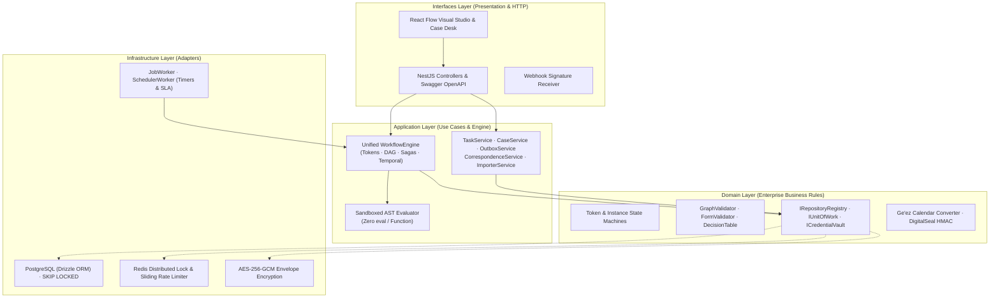
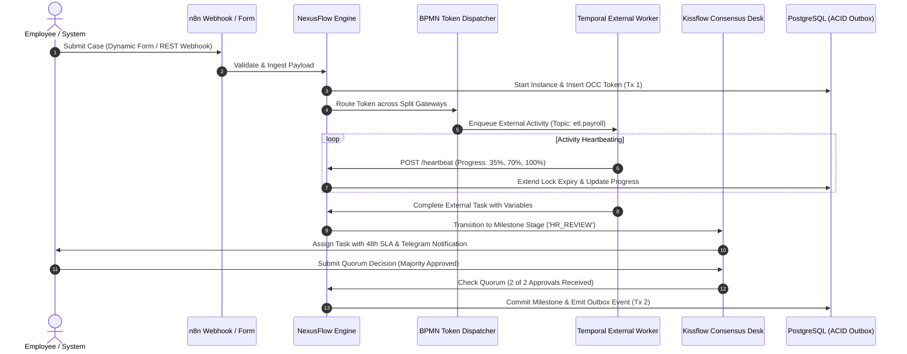
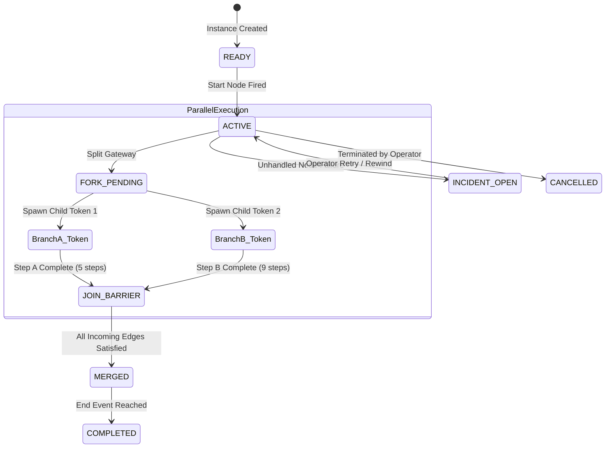
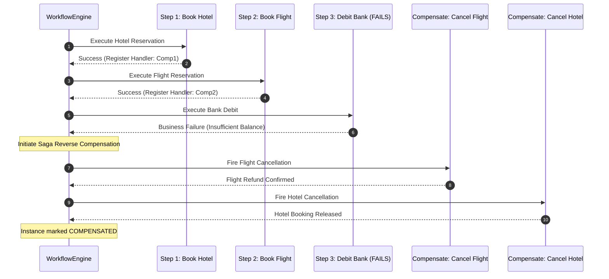
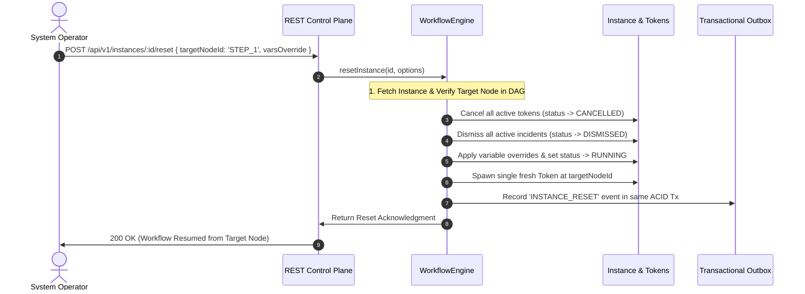
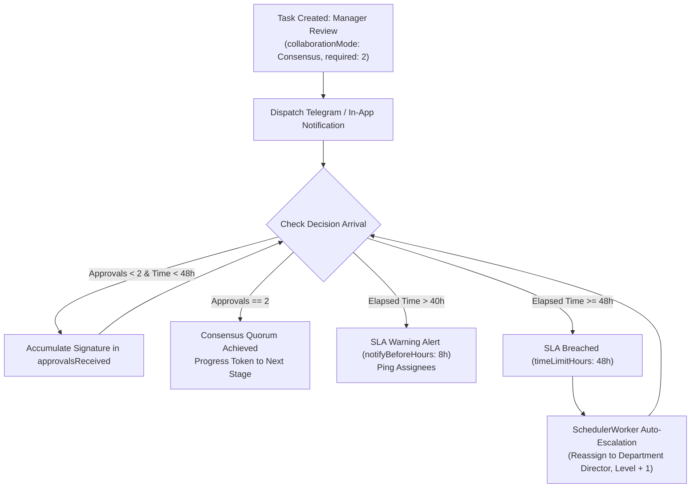
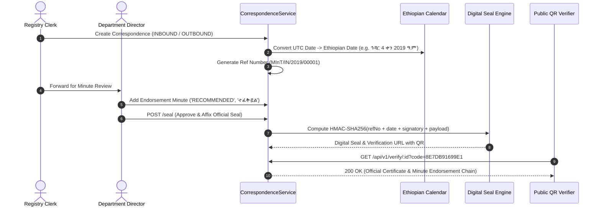

# NexusFlow: Software Design Document (SDD)
## Unified Multi-Paradigm Workflow Orchestration Platform
### Reverse-Engineering Camunda, n8n, Kissflow, and Temporal into a Single Enterprise Engine

---

## 1. System Architecture & High-Level Design

NexusFlow is architected according to **Clean Architecture** and **Hexagonal (Ports & Adapters)** principles. Enterprise business rules have zero dependencies on web frameworks, database drivers, or third-party SDKs.



---

## 2. End-to-End Architectural Flow Diagrams

### 2.1 Unified 4-in-1 Engine Execution Flow
This diagram illustrates how a single business case flows seamlessly across all four reverse-engineered paradigms:



---

### 2.2 Token Concurrency & Fork/Join Barrier Synchronization (Camunda)
NexusFlow implements strict Petri-net token semantics. When reaching a parallel gateway, the parent token transitions to `BRANCHING`, spawning child tokens. The join gateway waits for all parallel incoming tokens before continuing:



---

### 2.3 Saga Reverse Rollback Compensation (Camunda)
When a multi-step distributed transaction experiences a terminal business failure downstream, NexusFlow traverses completed compensation-enabled steps in exact reverse chronological order:



---

### 2.4 Temporal Point-in-Time Reset (Time Travel Rewind)
In production, bugs or third-party downtime often poison workflows. NexusFlow enables deterministic time travel:



---

### 2.5 Multi-Party Consensus Quorum & 48h SLA Escalation (Kissflow)
Handles collaborative human decision-making with strict time boundaries and automated hierarchy escalation:



---

### 2.6 Ethiopian Digital Correspondence & Sealing Flow
Bilingual Ge'ez calendar document registry, minute sheets, and HMAC-SHA256 digital seals:



---

## 3. Data Architecture & Database Schema (Drizzle ORM)

### 3.1 Relational Entity Model
All entities are strictly partitioned by `tenant_id` for multi-tenant isolation:

```
+----------------------------------------------------------------------------------------------------+
|                                         POSTGRESQL SCHEMA                                          |
|                                                                                                    |
|  +--------------------+         +------------------------+         +----------------------------+  |
|  |     tenants        |<---+    |       workflows        |<---+    |     workflow_instances     |  |
|  +--------------------+    |    +------------------------+    |    +----------------------------+  |
|  | id (PK)            |    |    | id (PK)                |    |    | id (PK)                    |  |
|  | slug               |    +----| tenant_id (FK)         |    +----| workflow_id (FK)           |  |
|  | name               |    |    | key                    |    |    | tenant_id (FK)             |  |
|  | status             |    |    | version                |    |    | parent_instance_id         |  |
|  +--------------------+    |    | definition (JSONB)     |    |    | status (RUNNING/COMPLETED) |  |
|                            |    +------------------------+    |    | current_stage              |  |
|                            |                                  |    | sla_status (ON_TRACK/BREACH) |
|                            |                                  |    | variables (JSONB)          |  |
|                            |    +------------------------+    |    | occ_version (INT)          |  |
|                            +----|       user_tasks       |    |    | generation (INT)           |  |
|                            |    +------------------------+    |    | parent_close_policy        |  |
|                            |    | id (PK)                |    |    +----------------------------+  |
|                            |    | instance_id (FK)-------+----+                  |                 |
|                            |    | token_id               |                       |                 |
|                            |    | candidate_group        |                       v                 |
|                            |    | required_approvals     |         +----------------------------+  |
|                            |    | approvals_received     |         |      execution_tokens      |  |
|                            |    | due_at / sla_breached  |         +----------------------------+  |
|                            |    +------------------------+         | id (PK)                    |  |
|                            |                                       | instance_id (FK)           |  |
|                            |    +------------------------+         | current_node_id            |  |
|                            +----|     external_tasks     |         | status (ACTIVE/WAITING)    |  |
|                                 +------------------------+         +----------------------------+  |
|                                 | id (PK)                |                                         |
|                                 | topic                  |         +----------------------------+  |
|                                 | worker_id / locked_until|        |       outbox_events        |  |
|                                 | last_heartbeat_at      |         +----------------------------+  |
|                                 | progress (0-100)       |         | id (PK), event_type        |  |
|                                 +------------------------+         | payload, published_at      |  |
+--------------------------------------------------------------------+-------------------------------+
```

### 3.2 High-Throughput Concurrency & Locking Strategy
1. **Pessimistic Worker Claiming (`FOR UPDATE SKIP LOCKED`)**:
   Background workers poll `external_tasks` and `scheduled_jobs` using non-blocking row-level locks, completely preventing lock contention across 50+ concurrent worker pods.
2. **Optimistic Concurrency Control (OCC)**:
   Workflow instance mutations check `WHERE id = :id AND occ_version = :expectedVersion`. Any concurrent token advancement increments `occ_version`. In case of a collision, the transaction rolls back cleanly and retries with full jitter.

---

## 4. Security & Cryptographic Model

1. **Envelope-Encrypted Credential Vault (AES-256-GCM)**:
   Third-party API keys and OAuth tokens are never stored in plain text. Stored records include 96-bit initialization vectors (`iv`), 128-bit authentication tags (`authTag`), and support zero-downtime key rotation (`VAULT_MASTER_KEY_V1` / `V2`).
2. **SSRF Guard & Outbound Firewall**:
   All dynamic HTTP actions resolve hostnames to IP addresses before initiating requests. Any attempt to reach loopback (`127.0.0.1`), private RFC1918 subnets (`10.0.0.0/8`, `172.16.0.0/12`, `192.168.0.0/16`), or cloud metadata endpoints (`169.254.169.254`) throws a fatal `SecurityViolationError`.
3. **Cryptographic Digital Seal (HMAC-SHA256)**:
   Documents and correspondence endorsements are signed using a server-side HMAC secret. Verification URLs contain truncated authentication digests (`code=8E7DB91699E1`) allowing instant public ledger verification without exposing private keys.

---

## 5. Verification & Compliance Standards

- **BPMN 2.0 Compliance**: Parallel Split, Parallel Join, Call Activity, User Task, Service Task, Boundary Timer, Intermediate Message Catch.
- **DMN 1.3 Compliance**: Single-hit (`FIRST`) and multi-hit (`COLLECT`) decision logic.
- **PACELC / CAP Properties**: Consistent (CP) on state transitions within a partition; Available (AP) on read-only live queries and external task polling.
- **Zero-Downtime Migration**: PostgreSQL schema managed via idempotent Drizzle migrations.

